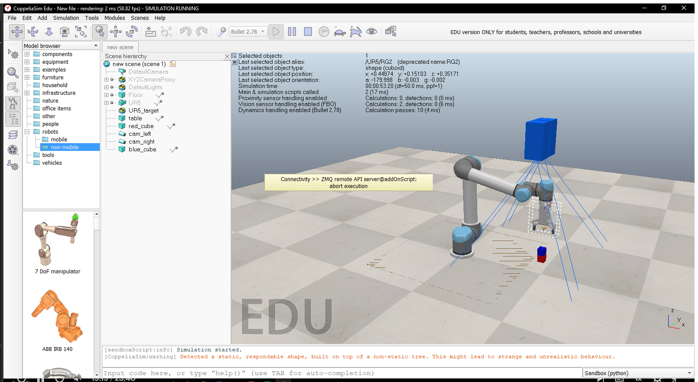
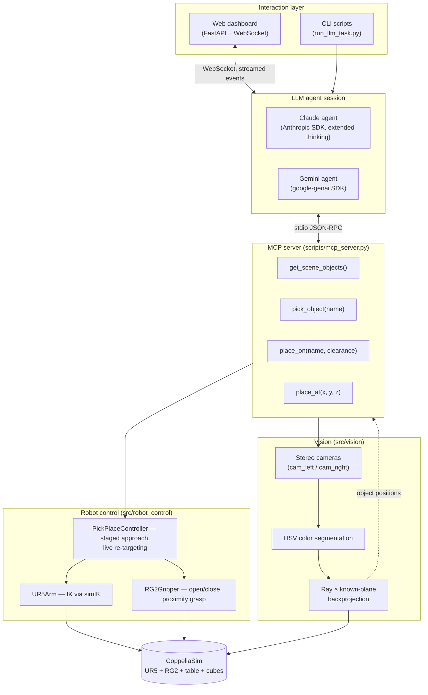

# robot-reasoning

**Semantic reasoning for robotic manipulation: can an LLM look at a scene, reason about what the task *means*, and correctly drive a robotic arm to do it?**

A master's research testbed where an LLM (Claude or Gemini) receives a scene through a stereo-vision pipeline and a tool-calling interface, and has to decide — on its own — what "put out the fire" means when the "fire" is a red cube and the "water" is a blue one.

<p align="center">
  
</p>

<p align="center">
  
  
  
  
  
</p>

---

## What this is

A UR5 arm with an RG2 gripper sits over a table with two cubes in a [CoppeliaSim](https://www.coppeliarobotics.com/) simulation. A stereo camera pair watches the table. An LLM is given a natural-language task — e.g. *"the red cube is lava, the blue cube is water, put out the fire"* — and a small set of tools: look at the scene, pick something up, put it somewhere. Nothing in the tool interface tells the model what "fire" or "water" means, or that stacking one cube on the other is the right move. That inference is the entire point of the research question.

The system is **provider-agnostic by design**: the robot is exposed over the [Model Context Protocol](https://modelcontextprotocol.io/), so any MCP-capable LLM client can drive it. Claude and Gemini are implemented and validated end-to-end; GPT is architecturally a drop-in (same tool contract, new adapter) and is the next provider planned, ahead of the comparative benchmark phase.

## Architecture



**Why it's built this way:** the LLM never touches simulator internals. It sees the world only through `get_scene_objects()` (vision-derived coordinates, not ground truth) and acts only through `pick_object` / `place_on` / `place_at`. That boundary is what makes the setup meaningful as a reasoning benchmark instead of a scripted demo — and it's also what makes the same tool server reusable from a terminal script, a web dashboard, or a different LLM entirely.

## How a task actually runs

1. **Perception.** Two calibrated vision sensors capture the table. Each colored cube is segmented in HSV (tuned to reject the robot's own paint), and its 3D position is recovered by intersecting each camera's ray with the known table plane — not by raw stereo depth triangulation (see [*why ray–plane, not stereo depth*](#engineering-notes) below).
2. **Reasoning.** The LLM receives the task prompt and the MCP tool list. It calls `get_scene_objects()`, reasons about the scenario semantically (nothing in the tools says "red = fire"), and plans a sequence of actions.
3. **Action.** `pick_object("blue")` drives the arm through a staged approach (well above → hover → slow final descent) to avoid sweeping the open gripper through the target, closes the gripper, and confirms the grasp via a proximity sensor. `place_on("red")` **re-reads the target's live position at every stage** of the motion — if something moves the red cube mid-task, the arm corrects instead of placing blind.
4. **Feedback loop.** Every tool call and result goes back to the model as a `tool_result`; the model keeps reasoning turn by turn until it emits a final answer with no further tool calls.
5. **Logging.** Every turn — thinking, text, tool call, tool result — is captured in a structured JSON transcript (`docs/transcripts/`) and, in the dashboard, streamed live over WebSocket.

## Project structure

```text
robot-reasoning/
├── sim/phase1_pick_place.ttt     # saved CoppeliaSim scene (rebuilt by build_scene_phase1.py)
├── src/
│   ├── robot_control/            # Phase 1 — arm + gripper + pick/place
│   │   ├── connection.py         #   ZMQ remote API session wrapper
│   │   ├── arm.py                #   UR5Arm: simIK-based inverse kinematics
│   │   ├── gripper.py            #   RG2Gripper: open/close + proximity-sensor grasp
│   │   └── pick_place.py         #   PickPlaceController: staged motion, live re-targeting
│   ├── vision/                   # Phase 2 — stereo perception
│   │   ├── camera.py             #   SimCamera: capture + intrinsics from the sensor
│   │   ├── color_detect.py       #   HSV segmentation
│   │   ├── triangulate.py        #   stereo triangulation + ray/plane backprojection
│   │   └── pipeline.py           #   VisionPipeline: images → {color: (x,y,z)}
│   ├── llm_agent/                # Phase 4 — LLM ⇄ MCP agent loops
│   │   ├── claude_agent.py       #   ClaudeAgentSession (Anthropic SDK)
│   │   └── gemini_agent.py       #   GeminiAgentSession (google-genai SDK)
│   └── webapp/                   # Phase 4 — live dashboard
│       ├── app.py                #   FastAPI + WebSocket event streaming
│       ├── camera_feed.py        #   direct camera snapshots for the UI
│       └── static/index.html     #   single-file dashboard (no build step)
├── scripts/
│   ├── build_scene_phase1.py     # builds/rebuilds the CoppeliaSim scene from scratch
│   ├── mcp_server.py             # Phase 3 — MCP server exposing the robot as tools
│   ├── run_llm_task.py           # CLI: run one task through Claude or Gemini
│   ├── run_webapp.py             # launches the dashboard
│   ├── start_all.py              # one command: sim + scene + dashboard + browser
│   └── test_*.py                 # regression tests (see below)
└── docs/
    ├── transcripts/              # saved JSON transcripts of real agent runs
    └── screenshots/              # (gitignored) ad-hoc visual captures
```

## Getting started

**Prerequisites**
- Windows + [CoppeliaSim EDU](https://www.coppeliarobotics.com/) (free for students/researchers)
- Python 3.14 (a dedicated venv is used throughout — nothing here depends on the system interpreter)
- An API key for whichever LLM you want to drive the robot: a free [Google AI Studio](https://aistudio.google.com/apikey) key for Gemini, and/or an [Anthropic](https://console.anthropic.com/settings/keys) key for Claude

```bash
python -m venv .venv
.venv/Scripts/python.exe -m pip install -r requirements.txt

cp .env.example .env        # then fill in GOOGLE_API_KEY and/or ANTHROPIC_API_KEY
```

### Run everything

```bash
.venv/Scripts/python.exe scripts/start_all.py
```

Opens CoppeliaSim (if it isn't already running), rebuilds the scene, starts the dashboard, and opens it in your browser at `http://localhost:8000`. Type a task, watch the robot reason and move.

### Run a single task from the CLI

```bash
.venv/Scripts/python.exe scripts/run_llm_task.py --provider gemini
.venv/Scripts/python.exe scripts/run_llm_task.py --provider claude --model claude-haiku-4-5 \
    --task "the red cube is lava, the blue cube is water, put out the fire"
```

### Other entry points

| Script | What it does |
|---|---|
| `build_scene_phase1.py` | (Re)builds the UR5 + RG2 + table + cubes + stereo rig scene |
| `run_pick_place_demo.py` | Pick-and-place with hard-coded coordinates (Phase 1 validation) |
| `run_vision_pick_place.py` | Pick-and-place driven entirely by the vision pipeline (Phase 2 validation) |
| `test_vision.py` | Validates detected cube positions against simulator ground truth |
| `test_moving_target.py` | Proves `place_on` corrects its aim when the target moves mid-task |
| `test_*_dry_run.py` | Exercises the full MCP ⇄ agent ⇄ robot loop with a mocked LLM (no API cost) |

## MCP tool surface

This is the entire interface the LLM is given — everything above it (prompting, reasoning, planning) is the model's own doing.

| Tool | Arguments | Behavior |
|---|---|---|
| `get_scene_objects()` | — | Runs the vision pipeline fresh; returns `{color: {x,y,z}}` for every detected cube, plus cube size and whether the gripper is holding something. **An object disappears from this list while it's in the gripper** — the camera can't see inside it. |
| `pick_object(object_name)` | object name | Re-detects the object live, approaches in stages, grasps, confirms via proximity sensor |
| `place_on(object_name, clearance_m?)` | target object name, optional height offset | Re-reads the target's position at **every stage** of the motion — safe against the target moving mid-task |
| `place_at(x, y, z)` | world coordinates | Places at a fixed coordinate with no live re-check — for open space, or to test a model's own spatial math |

## Validated results

| What | Result |
|---|---|
| Vision 3D localization error | **0.16–0.34 cm** against simulator ground truth (two cubes, repeated runs) |
| Pick-and-place placement error (scripted) | **0.0 cm** (within measurement resolution) across repeated runs |
| Live LLM task (Gemini) — "put out the fire" | Correctly reasoned the metaphor, called `get_scene_objects → pick_object(blue) → place_on(red)`, self-recovered from a transient `503`, placed the cube 1 mm from the target center |
| Live-tracking under disturbance | Target cube displaced **15.7 cm** mid-motion; `place_on` corrected and landed within 1 mm of the *new* position instead of the stale one |

Full transcripts of real runs — thinking blocks, every tool call, every result — are in [`docs/transcripts/`](docs/transcripts/).

## Engineering notes

A few non-obvious things that cost real debugging time and are worth knowing if you extend this:

- **Vision sensors default to orthographic projection.** `sim.createVisionSensor` needs `options` bit 1 set (`options=2`) for perspective mode — without it, the whole pinhole-camera model used for triangulation is operating on the wrong projection and every downstream number is wrong in a way that *looks* like a sign-convention bug but isn't.
- **3D localization is ray × known-plane, not stereo depth triangulation.** With a camera baseline small relative to scene depth, raw stereo triangulation is extremely sensitive to a few pixels of detection noise. Since the table height is known, intersecting each camera's ray with that plane is both simpler and far more accurate here.
- **UR5's zero-joint pose is a kinematic singularity.** IK tracking initialized from the all-zero home configuration is numerically unstable; the arm is moved to a safe "ready" configuration before any IK-driven motion starts.
- **IK must drive *dynamic*-mode joints, not kinematic-mode ones.** Switching the joints to kinematic mode to "simplify" control actually breaks `simIK`'s ability to hold position against gravity between simulation steps — the opposite of what kinematic mode sounds like it should do. Dynamic mode + `simIK.handleGroup(..., syncWorlds=True)` is what actually works.
- **The RG2 gripper's base ships as a free dynamic body.** Mounted directly on the arm, it would free-fall under gravity independent of the arm's own motion unless explicitly marked static after attachment.
- **Color detection needs a saturation floor, not just a hue window.** The robot's own light-blue trim falls inside a naive "blue" hue range; requiring high saturation separates the object's pure color from the robot's desaturated paint.

## Roadmap

- [x] Phase 0 — Simulator + robot environment
- [x] Phase 1 — Inverse kinematics, pick-and-place
- [x] Phase 2 — Stereo vision pipeline
- [x] Phase 3 — MCP tool server
- [x] Phase 4 — LLM agents (Claude, Gemini) + live dashboard
- [ ] GPT agent (same MCP contract, new adapter)
- [ ] Comparative benchmark across providers (task success rate, reasoning quality, cost, latency)
- [ ] Closed-loop visual servoing (current live-tracking re-checks *between* motion stages, not continuously *during* one)
- [ ] Sim-to-real on low-cost hardware (e.g. LeRobot SO-101)

## Tech stack

| Layer | Choice |
|---|---|
| Simulator | CoppeliaSim EDU + `simIK` |
| Robot / gripper | UR5 + RG2 |
| Sim ↔ Python | `coppeliasim-zmqremoteapi-client` (ZMQ remote API) |
| Vision | OpenCV, NumPy |
| Tool protocol | Model Context Protocol (`mcp`) over stdio |
| LLMs | Claude (`anthropic`), Gemini (`google-genai`) |
| Dashboard | FastAPI, WebSockets, vanilla JS (no build step) |
| Secrets | `python-dotenv` (`.env`, gitignored) |

---

*Master's research project, public university (Brazil). Research question: can semantic/commonsense reasoning in an LLM be reliably grounded into correct, physically-executed robotic actions through a standardized tool interface.*
